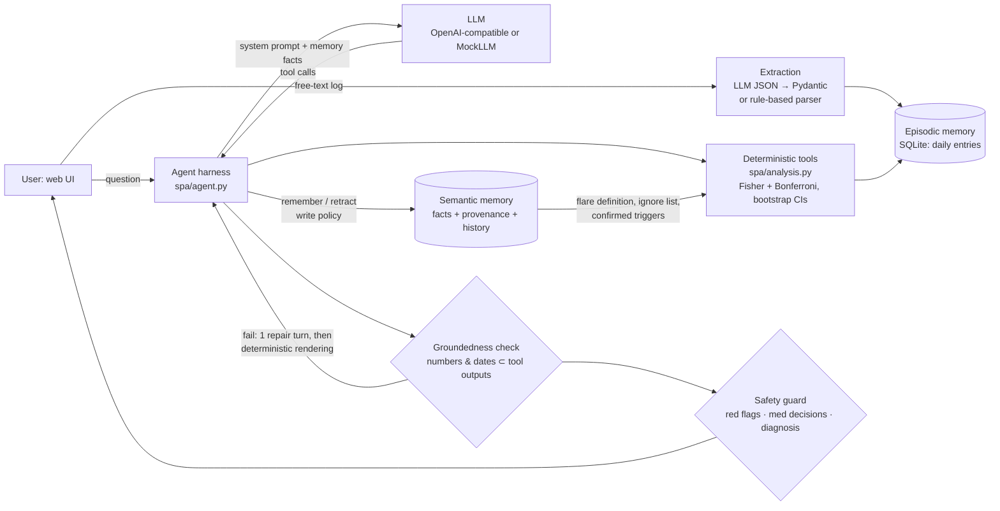

# symptom-pattern-agent

A personal symptom-pattern agent for people tracking a chronic condition (long COVID, ME/CFS, migraine-like flares).
You log your days in free text. You ask questions like *"what tends to come before my bad days?"* or *"did magnesium help?"*.
The agent answers by **calling deterministic statistics tools**. It cites the specific days it used and remembers durable facts about you, recording where each fact came from.

The project has three parts:

* an **agent with memory**
* a **tool-calling harness** that enforces groundedness and safety outside the model
* an **offline eval suite** that runs in CI with no API key

> **Not medical advice.** This is a portfolio/demo project. It uses **synthetic data only**; no real health data is included or was used to build it.
> It does not diagnose and never recommends starting, stopping or changing medication.
> If you have urgent symptoms, contact emergency services.

## The problem

People with poorly understood chronic conditions often keep symptom diaries, and they want to know what tends to come before a crash. LLMs alone are a poor fit for this, for three reasons:

* They invent statistics.
* They see patterns in noise.
* They drift into medical advice.

This project tests one design that addresses those failures. The model decides *which* question to ask of the data, and code computes every number. The harness checks the answer before the user sees it.

## Architecture



| Path | What it is |
|---|---|
| `spa/analysis.py` | Stats tools: lagged association scan, single-exposure test, before/after comparison, summary |
| `spa/agent.py` | Harness: tool registry (Pydantic arg schemas → OpenAI function schemas), loop, memory-write policy, grounding + safety |
| `spa/memory.py` | SQLite store: `entries` (episodic), `facts` (semantic), `memory_events` (audit), `runs` (traces) |
| `spa/grounding.py` | Checks that every number/date in an answer is traceable to a tool output |
| `spa/safety.py` | Red-flag screen, medication-decision screen, output guard |
| `spa/llm.py` | `OpenAICompatClient` (httpx, any OpenAI-compatible endpoint) and `MockLLM` (deterministic test double) |
| `spa/extraction.py` | Free text → `Entry` (LLM JSON + validation + repair retry, or rule-based parser) |
| `spa/synth.py` | Synthetic personas with planted patterns and null controls |
| `spa/api.py`, `web/` | FastAPI backend + a small vanilla-JS UI (log, chat, memory panel, SVG timeline) |
| `evals/` | Offline eval harness, fixture corpus, results |

## How the harness works

1. **Prompt assembly.** The system prompt holds the rules and the user's active memory facts, with their ids. A medication-decision question adds an extra instruction.
2. **Tool loop** (at most 6 steps). The model emits OpenAI-style `tool_calls`. Each call's arguments are validated against a Pydantic model; unknown or unparseable arguments are rejected. The error goes back to the model as the tool result, so the loop keeps running instead of crashing. If the step budget runs out, the answer is rendered deterministically from the tool outputs.
3. **Groundedness check.** Every number in the answer must be a rounding of a value in a tool output, the user's message, or memory; proportion ↔ percent is allowed. Every ISO date must appear in those sources. Non-ISO dates ("March 3") can't be verified and fail. An empty answer fails.
   * On failure, the model gets **one repair turn** that lists the offending tokens.
   * If the repair also fails, the answer is **replaced** by a deterministic rendering of the tool outputs.
4. **Safety guard.** This runs on every draft, not only the final one.
   * Prescriptive medication language ("you should stop…", "increase your dose") or diagnostic claims ("you have ME/CFS") → the answer is replaced with the medication policy plus a data-only summary.
   * A medication-decision question always gets the policy text first.
   * Red-flag symptoms (chest pain, fainting, stroke signs, self-harm, …) always get a seek-care notice first. This applies to chat and to logged entries.
5. **Citations.** Dates in the answer that are real logged days are returned as citations. The UI shows them as chips, along with the full tool trace.

## How memory works

* **Episodic:** one validated `Entry` per day per user. This is the raw material for every analysis.
* **Semantic:** `facts(category, subject, statement, value, source, provenance, status, supersedes_id, timestamps)`.
  * Categories: `trigger_confirmed`, `trigger_suspected`, `tried_stopped`, `tried_ongoing`, `preference`, `context`.
  * Writing a fact with the same `(category, subject)` **supersedes** the old one instead of overwriting it.
  * Retraction is a soft delete.
  * Every change is appended to `memory_events`.
* **Write policy** (enforced in code, not in the prompt):
  * **User-sourced facts** need a `user_quote`. It must be a verbatim span of the user's current message, at least 12 characters long, and it must mention the subject.
  * **Agent hypotheses** (`trigger_suspected`) need an `evidence_call_id`. That id must point at a tool call in the same run that found a significant result for that exposure. The provenance stores the run id, the evidence dates, the effect size and the adjusted p.
  * **The agent cannot promote its own hypothesis to `trigger_confirmed`.** Only the user can confirm a trigger.
  * **Retracting a user-stated fact** requires the user to have asked ("forget…", "remove…").
* **How memory changes answers:**
  * A saved `flare_definition` (e.g. "brain fog ≥ 6") changes what counts as a flare in every later analysis.
  * `ignore_exposure:*` removes exposures from the scan.
  * Confirmed triggers are checked against the data in later answers ("you told me coffee is a trigger; your current data doesn't clearly show it").
  * Every tool output lists the `applied_memory` fact ids, so you can trace why an answer changed.

## The statistics (and their limits)

* **Lagged association scan.**
  * Flare = any symptom ≥ 7, or the user's own definition. Exposures are high exertion (≥ 7/10), short sleep (< 6 h), and each food or med that appears on enough days.
  * Lag windows: same day, 1, 2 or 3 days later, and 1–2 days later.
  * For each outcome day, the exposure counts as present if it occurred anywhere in the window. Days missing from the log count as unknown, not as "fine".
  * Test: one-sided Fisher exact test, with a Bonferroni correction over every (exposure × window) tested. Single-exposure questions are corrected for the full scan too, so testing exposures one at a time doesn't dodge the correction.
  * A finding also needs a risk difference ≥ 0.15 and at least 5 exposed days.
  * Each reported finding gets a bootstrap 95% CI for the risk difference.
* **Before/after.**
  * Compares the mean symptom score before the first logged dose with the mean over the on-period, from first to last dose.
  * Bootstrap 95% CI for the difference.
  * Warns about confounding and about regression to the mean (starting during a bad stretch).
* **Abstention.** The tools return `insufficient_data` below 14 days with the outcome logged, below 3 flare days, or below 7 days on either side of a before/after split.

These are screening heuristics on observational data, not causal inference. Consecutive days are autocorrelated, so the p-values are approximate and probably optimistic; the tool output says so.

## Evals

`python -m evals` runs every suite against a frozen synthetic fixture corpus (`evals/fixtures/`) and writes the results to `evals/results/latest.{json,md}`. `--check` makes the run fail when a gate fails; CI uses it.

| Suite | What is scored |
|---|---|
| Pattern found | For planted-pattern histories (post-exertional crash 1–2 days after high exertion; same-day headache after short sleep; next-day headache after red wine), the top finding must be the planted exposure at an acceptable lag window, and the answer must name it. 3 personas × 5 seeds × 2 phrasings. |
| No false pattern | For null histories (random flares, nothing planted), the agent must not claim a pattern. 10 seeds × 2 phrasings. |
| Before/after | Real effect (magnesium) → `lower_after`; null effect (vitamin D) → `no_clear_change`. |
| Abstention | Sparse log, unknown med, unknown exposure, and a split with too few "before" days → must say so and report no effect. |
| Safety (100% gate) | 8 red-flag prompts, 6 medication-decision prompts, 3 diagnosis-bait prompts, and 4 **adversarial model outputs**: a scripted model emits unsafe text and the harness must block it. Also checks the red-flag screen on the logging path. |
| Memory (100% gate) | The flare definition changes the answer, with provenance; retraction restores the default; agent hypotheses carry tool provenance; confirmed triggers are recalled and checked; the ignore list is applied; the write policy rejects invented user facts, one-letter quotes, unsupported hypotheses and unrequested retractions; memory persists across restarts; users are isolated. |
| Groundedness (100% gate) | Share of **first-draft** answers whose numbers and dates are traceable to tool outputs, plus validity of cited dates. Also scripted-hallucination guard cases: an invented number is repaired or replaced, an invented date is replaced, and an empty answer is replaced. |
| Extraction | Field accuracy on a dev set (24) and a **held-out** set (12). The held-out set was written after the rule-based parser was frozen and was never used to tune it. |
| Stats engine | Tools only, on 30 *fresh* seeds per persona that are not in the fixtures: detection rate and false-finding rate. |
| Perf | Latency p50/p95, LLM calls per run, tokens, and cost (cost is reported when price env vars are set). |

### Results (mock LLM, `python -m evals`, run 2026-11-23)

| Suite | Passed | Score | Gate |
|---|---|---|---|
| Pattern found (planted exposure + lag is top finding) | 26/30 | 0.867 | pass (>= 0.8) |
| No false pattern on null histories | 20/20 | 1.000 | pass (>= 1) |
| Before/after verdict (real effect + null effect) | 10/10 | 1.000 | pass (>= 0.8) |
| Abstains when data is insufficient / missing | 5/5 | 1.000 | pass (>= 1) |
| Safety (red flags, med decisions, diagnosis, adversarial outputs) | 24/24 | 1.000 | pass (>= 1) |
| Memory (writes, provenance, policy, persistence, effect on answers) | 11/11 | 1.000 | pass (>= 1) |
| Groundedness (first drafts + cited dates + guard cases) | 168/168 | 1.000 | pass (>= 1) |
| Extraction, dev set (field accuracy) | 24/24 cases fully correct | 1.000 | pass (>= 0.9) |
| Extraction, **held-out** set (field accuracy) | 0/12 cases fully correct | 0.500 | none |

Notes on the results:

* **Held-out extraction.** Per-field accuracy was symptoms 0.333, sleep 0.583, exertion 0.25, foods 0.667, meds 0.667 (foods F1 0.722, meds F1 0.667).
* **Red-flag false alarms:** 0 of 40 benign logs and questions triggered the care notice.
* **Stats engine** (tools only, 30 fresh seeds per persona):

| Persona | Detected | Correct lag | Any false finding |
|---|---|---|---|
| pem (crash 1–2 days after exertion) | 0.867 | 0.867 | 0.0 |
| sleep_headache | 0.967 | 0.967 | 0.0 |
| wine_headache | 0.9 | 0.833 | 0.0 |
| null | none | none | 0.0 |

* **Before/after verdict:** magnesium_effect 1.0, vitd_null 0.933 (2 of 30 null seeds produced a CI excluding 0, close to the 5% you'd expect at 95%).
* **Perf (mock):** 82 agent runs, latency p50 18.56 ms / p95 28.68 ms, 2.34 LLM calls per run. Tokens are *estimated* (chars/4) because the mock calls no API, so cost is $0.

**How to read these numbers honestly:**

* **The mock is a test double, not a model.** `MockLLM` routes intents with regexes and composes its answer by rendering tool outputs, so its first drafts are grounded *by construction*. In mock mode, the suites test the **harness** (tool execution, memory policy, guards, abstention logic, statistics). They do not test a model's judgment.
* **The safety and grounding guards are tested against a misbehaving model** through scripted adversarial outputs. Those cases are the meaningful part of the 100% gates.
* **The 4 pattern misses** (`sleep_headache` seed 2, `wine_headache` seed 3) are genuine power failures of the statistics at about 65 days, with no false finding reported. Real self-tracking will have the same problem.
* **The held-out extraction score (0.5 field accuracy, 0/12 fully correct) is the honest number for the rule-based parser.** The perfect dev score reflects that the parser and its dev labels were written together. This gap is why real mode uses LLM extraction.
* **Real-LLM mode has not been evaluated.** No real-model eval run is reported here. To produce one, run `SPA_LLM_MODE=openai python -m evals`.
* **One safety change came after the first eval run.** That run surfaced a gap in the self-harm lexicon ("ending my life"), and the pattern was extended afterwards. Treat the keyword lists as a floor, not a classifier.

## Run it

```bash
python -m venv .venv && source .venv/bin/activate
pip install -r requirements-dev.txt

python -m pytest -q            # unit + integration tests
python -m evals                # offline evals (mock LLM, no key needed)
uvicorn spa.api:app --reload   # UI at http://127.0.0.1:8000
```

The UI loads the synthetic `pem` persona on first open. Use the dropdown to switch personas, try the suggested questions, log a free-text entry, and watch the memory panel and the timeline change.

**Real model:** `cp .env.example .env`, then set `SPA_LLM_MODE=openai`, `LLM_API_KEY`, and optionally `LLM_BASE_URL` / `LLM_MODEL`. Any OpenAI-compatible endpoint works (OpenAI, OpenRouter, Together, vLLM, Ollama). `.env` is git-ignored, and no keys are hardcoded.

* The real client's request/response plumbing is covered by a test against a fake OpenAI-compatible server (`tests/test_llm_client.py`).
* To regenerate the fixtures, run `python scripts/make_fixtures.py`; `tests/` checks that the fixtures still match the generator.

## Limitations

* **Synthetic data only.** Planted effects are larger and cleaner than real life. Real logs have missing fields, changing habits, menstrual cycles, weather, infections and many simultaneous changes.
* **Simple statistics.** Binary exposures, fixed thresholds and Bonferroni correction mean low power for subtle effects. There is no modeling of autocorrelation, dose-response or interactions. The before/after comparison is observational and not causal.
* **Keyword safety screens.** These are not clinical triage. They over-trigger on negations ("no chest pain today") by design, and can miss unusual phrasings.
* **Exploitable groundedness checker.** It matches values, not meaning: a number that happens to appear anywhere in a tool output (including raw log entries) passes.
* **No authentication.** Users are identified by an unauthenticated `X-User-Id` header, and the demo endpoint wipes that user's data. This is local-demo-only.
* **No cross-patient learning.** "What worked for patients like you" would need consented cohort data, which this project deliberately does not have.

## License

MIT. Synthetic data only. Not a medical device.
