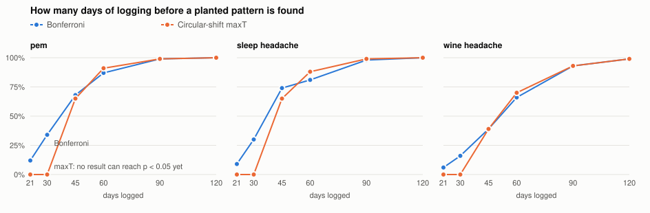

# symptom-pattern-agent

A personal symptom-pattern agent for people tracking a chronic condition (long COVID, ME/CFS, migraine-like flares).
You log your days in free text. You ask questions like *"what tends to come before my bad days?"* or *"did magnesium help?"*.
The agent answers by **calling deterministic statistics tools**. It cites the specific days it used and remembers durable facts about you, recording where each fact came from.

The project has three parts:

* an **agent with memory**
* a **tool-calling harness** that enforces groundedness and safety outside the model
* an **offline eval suite** that runs in CI with no API key

> **Not medical advice.** This is a portfolio/demo project. It uses **synthetic data only**; no real health data is included or was used to build it.
> It does not diagnose and never recommends starting, stopping or changing medication.
> If you have urgent symptoms, contact emergency services.

## The problem

People with poorly understood chronic conditions often keep symptom diaries, and they want to know what tends to come before a crash. LLMs alone are a poor fit for this, for three reasons:

* They invent statistics.
* They see patterns in noise.
* They drift into medical advice.

This project tests one design that addresses those failures. The model decides *which* question to ask of the data, and code computes every number. The harness checks the answer before the user sees it.

## Architecture


| Path | What it is |
|---|---|
| `spa/analysis.py` | Stats tools: lagged association scan, single-exposure test, before/after comparison, summary |
| `spa/agent.py` | Harness: tool registry (Pydantic arg schemas → OpenAI function schemas), loop, memory-write policy, grounding + safety |
| `spa/memory.py` | SQLite store: `entries` (episodic), `facts` (semantic), `memory_events` (audit), `runs` (traces) |
| `spa/grounding.py` | Checks that every number/date in an answer is traceable to a tool output |
| `spa/safety.py` | Red-flag screen, medication-decision screen, output guard |
| `spa/llm.py` | `OpenAICompatClient` (httpx, any OpenAI-compatible endpoint) and `MockLLM` (deterministic test double) |
| `spa/extraction.py` | Free text → `Entry` (LLM JSON + validation + repair retry, or rule-based parser) |
| `spa/synth.py` | Synthetic personas with planted patterns and null controls |
| `spa/report.py` | Doctor-visit report: one printable page built only from tool outputs, memory and flagged days |
| `spa/api.py`, `web/` | FastAPI backend + a small vanilla-JS UI (log, chat, memory panel, SVG timeline, flagged days, logging progress) |
| `evals/` | Offline eval harness, fixture corpus, results |

## How the harness works

1. **Prompt assembly.** The system prompt holds the rules and the user's active memory facts, with their ids. A medication-decision question adds an extra instruction.
2. **Tool loop** (at most 6 steps). The model emits OpenAI-style `tool_calls`. Each call's arguments are validated against a Pydantic model; unknown or unparseable arguments are rejected. The error goes back to the model as the tool result, so the loop keeps running instead of crashing. If the step budget runs out, the answer is rendered deterministically from the tool outputs.
3. **Groundedness check.** Numbers reach the answer in one of two ways:
   * **Slots (preferred).** Every tool result carries a short ref (`T1`, `T2`, …). The model writes `{{T1.findings.0.rate_exposed_pct}}%` instead of `44.4%`, and the harness fills in the value. The model never types the number, so it can't get it wrong, and every number is bound to one named field. The bindings are returned with the answer and shown in the UI ("where each number came from"). Filters: `|pct` (proportion → percent), `|r0`/`|r1`/`|r2`. A slot that points at a missing field fails like an invented number.
   * **Literals.** A typed number must be a rounding of a value in a *computed* field of a tool output, the user's message or memory; proportion ↔ percent is allowed. Raw log rows (from `get_entries`) are excluded from this pool, so a severity of 3 copied from some day can't pass as "3% of days". Raw values can still be quoted, but only through a slot.

   Every ISO date must appear in the sources. Non-ISO dates ("March 3") can't be verified and fail. An empty answer fails.
   * On failure, the model gets **one repair turn** that lists the offending tokens.
   * If the repair also fails, the answer is **replaced** by a deterministic rendering of the tool outputs.
4. **Safety guard.** This runs on every draft, not only the final one.
   * Prescriptive medication language ("you should stop…", "increase your dose") or diagnostic claims ("you have ME/CFS") → the answer is replaced with the medication policy plus a data-only summary.
   * A medication-decision question always gets the policy text first.
   * Red-flag symptoms (chest pain, fainting, stroke signs, self-harm, …) always get a seek-care notice first. This applies to chat and to logged entries.
5. **Citations.** Dates in the answer that are real logged days are returned as citations. The UI shows them as chips, along with the full tool trace.

## How memory works

* **Episodic:** one validated `Entry` per day per user. This is the raw material for every analysis.
* **Semantic:** `facts(category, subject, statement, value, source, provenance, status, supersedes_id, timestamps)`.
  * Categories: `trigger_confirmed`, `trigger_suspected`, `tried_stopped`, `tried_ongoing`, `preference`, `context`.
  * Writing a fact with the same `(category, subject)` **supersedes** the old one instead of overwriting it.
  * Retraction is a soft delete.
  * Every change is appended to `memory_events`.
* **Write policy** (enforced in code, not in the prompt):
  * **User-sourced facts** need a `user_quote`. It must be a verbatim span of the user's current message, at least 12 characters long, and it must mention the subject.
  * **Agent hypotheses** (`trigger_suspected`) need an `evidence_call_id`. That id must point at a tool call in the same run that found a significant result for that exposure. The provenance stores the run id, the evidence dates, the effect size and the adjusted p.
  * **The agent cannot promote its own hypothesis to `trigger_confirmed`.** Only the user can confirm a trigger.
  * **Retracting a user-stated fact** requires the user to have asked ("forget…", "remove…").
* **How memory changes answers:**
  * A saved `flare_definition` (e.g. "brain fog ≥ 6") changes what counts as a flare in every later analysis.
  * `ignore_exposure:*` removes exposures from the scan.
  * Confirmed triggers are checked against the data in later answers ("you told me coffee is a trigger; your current data doesn't clearly show it").
  * Every tool output lists the `applied_memory` fact ids, so you can trace why an answer changed.

## Bringing it to an appointment

The point of a symptom log is usually a conversation with a clinician. Two features serve that (the idea of a "doctor-ready summary" and flagged entries comes from hackathon trackers such as [Silent Symptom](https://github.com/shreya2707-glitch/silent-symptom)):

* **Flag a day.** Click any day on the timeline to flag it, with an optional note ("couldn't get out of bed"). Flags are stored separately from the log and never change the analysis.
* **Doctor visit report** (`/report`, button in the header). One printable page, also available as JSON from `/api/report`:
  * overview: logging period, coverage, flare days, per-symptom mean and max;
  * red-flag mentions found in the log text, with dates;
  * the days the patient flagged, with what was logged on each;
  * recent change: last 14 days vs the 28 before, with a bootstrap CI. A change is called only when the interval excludes zero, not on a fixed "+0.3 points = worsening" rule;
  * pattern findings with counts, risk difference, CI and adjusted p, or "no exposure stood out";
  * before/during comparisons for each medication or supplement with enough "before" days;
  * what the patient told the agent (confirmed triggers, tried and stopped), with their own words, kept separate from patterns the tool only suspects.

  **No LLM writes the report.** It is assembled from the same deterministic tools the agent calls, so it is grounded by construction; a test runs the groundedness checker over the rendered page. It describes data and says what the data can't show. It suggests no diagnosis or medication change.

**Logging progress.** The log panel shows days logged, coverage, the longest gap, and roughly how likely a strong pattern is to be detectable by now. That estimate comes from the power study below (about 84% at 70 days, about 27% at 30). It nudges you after a gap of 2 or more days.

## The statistics (and their limits)

* **Lagged association scan.**
  * Flare = any symptom ≥ 7, or the user's own definition. Exposures are high exertion (≥ 7/10), short sleep (< 6 h), and each food or med that appears on enough days.
  * Lag windows: same day, 1, 2 or 3 days later, and 1–2 days later.
  * For each outcome day, the exposure counts as present if it occurred anywhere in the window. Days missing from the log count as unknown, not as "fine".
  * Test: one-sided Fisher exact test per (exposure × window), then a multiple-comparison step. Three are implemented (`analysis.METHODS`):
    * `bonferroni` (default): p × number of tests.
    * `bh`: Benjamini-Hochberg false-discovery-rate control.
    * `maxt`: a circular-shift permutation test with a max-statistic (Westfall-Young) adjustment. Each test's rows keep their outcome and are paired with the exposure value *k* rows later, wrapping around. That destroys any real alignment but keeps each series' runs (busy weeks, multi-day crashes) intact. The adjusted p is the share of shifts whose *best* test beats the observed one. This handles multiplicity and autocorrelation together.
  * Single-exposure questions are adjusted for the full scan under every method, so testing exposures one at a time doesn't dodge the correction.
  * A finding also needs a risk difference ≥ 0.15 and at least 5 exposed days.
  * Each reported finding gets a bootstrap 95% CI for the risk difference.
* **Before/after.**
  * Compares the mean symptom score before the first logged dose with the mean over the on-period, from first to last dose.
  * Bootstrap 95% CI for the difference.
  * Warns about confounding and about regression to the mean (starting during a bad stretch).
* **Abstention.** The tools return `insufficient_data` below 14 days with the outcome logged, below 3 flare days, or below 7 days on either side of a before/after split.

These are screening heuristics on observational data, not causal inference.

**Why Bonferroni is still the default** (`python -m evals.power`, see [`evals/results/power.md`](evals/results/power.md)):

| Method (70 days, 100 fresh seeds) | pem | sleep_headache | wine_headache | False finding, independent null | False finding, autocorrelated null |
|---|---|---|---|---|---|
| Bonferroni (default) | 0.92 | 0.94 | 0.83 | 0.00 | 0.05 |
| Benjamini-Hochberg | 0.92 | 0.94 | 0.83 | 0.00 | 0.05 |
| Circular-shift maxT | 0.94 | 0.95 | 0.90 | 0.05 | 0.06 |

* **Autocorrelation is real and measurable.** Bonferroni's false-finding rate goes from 0% on independent days to 5% when busy spells and crash episodes come in runs, even though the two are unrelated. maxT stays at about its nominal 5% on both.
* **maxT buys a little power** (+2 to +7 points), but it reports a false pattern on about 1 in 20 null histories, where Bonferroni reports almost none. For a health tool a false pattern costs more than a missed one, so Bonferroni stays the default and maxT is a switch (`analysis.METHOD`).
* **BH changes nothing here.** The planted effects are either clearly significant or not, so FDR control and Bonferroni make the same calls.
* **maxT can't say anything before about 5 weeks.** The smallest possible p is 1 / (shifts + 1), so with fewer than about 34 usable rows no result can reach 0.05. The tool output says so.
* A first attempt at maxT rotated over calendar days and was too lenient (6.75% false findings on the independent null). Rotation misaligned the days missing from the log and shrank the null tables. It now rotates over logged rows, which keeps the table size fixed.

**How much logging does it take?** Detection rate by days of history (Bonferroni):

| Persona | 21 d | 30 d | 45 d | 60 d | 90 d | 120 d |
|---|---|---|---|---|---|---|
| pem (crash 1–2 days after exertion) | 0.12 | 0.34 | 0.68 | 0.87 | 0.99 | 1.00 |
| sleep_headache (same day) | 0.09 | 0.30 | 0.74 | 0.81 | 0.98 | 1.00 |
| wine_headache (next day, ~15% of days exposed) | 0.06 | 0.16 | 0.39 | 0.66 | 0.93 | 0.99 |



Even with the large, clean effects planted here, a month of logging finds the pattern less than a third of the time, and the rarer exposure (wine) needs about three months. Real effects will be smaller, so "keep logging" is the honest answer for most users in their first months. That is also why the 4 pattern misses in the suite above are expected.

## Evals

`python -m evals` runs every suite against a frozen synthetic fixture corpus (`evals/fixtures/`) and writes the results to `evals/results/latest.{json,md}`. `--check` makes the run fail when a gate fails; CI uses it.

| Suite | What is scored |
|---|---|
| Pattern found | For planted-pattern histories (post-exertional crash 1–2 days after high exertion; same-day headache after short sleep; next-day headache after red wine), the top finding must be the planted exposure at an acceptable lag window, and the answer must name it. 3 personas × 5 seeds × 2 phrasings. |
| No false pattern | For null histories (random flares, nothing planted), the agent must not claim a pattern. 10 seeds × 2 phrasings. |
| Before/after | Real effect (magnesium) → `lower_after`; null effect (vitamin D) → `no_clear_change`. |
| Abstention | Sparse log, unknown med, unknown exposure, and a split with too few "before" days → must say so and report no effect. |
| Safety (100% gate) | 8 red-flag prompts, 6 medication-decision prompts, 3 diagnosis-bait prompts, and 4 **adversarial model outputs**: a scripted model emits unsafe text and the harness must block it. Also checks the red-flag screen on the logging path. |
| Memory (100% gate) | The flare definition changes the answer, with provenance; retraction restores the default; agent hypotheses carry tool provenance; confirmed triggers are recalled and checked; the ignore list is applied; the write policy rejects invented user facts, one-letter quotes, unsupported hypotheses and unrequested retractions; memory persists across restarts; users are isolated. |
| Groundedness (100% gate) | Share of **first-draft** answers whose numbers and dates are traceable to tool outputs, plus validity of cited dates. Also scripted-hallucination guard cases: an invented number is repaired or replaced, an invented date is replaced, an empty answer is replaced, a slot is filled and bound to its field, a slot pointing at a missing field is replaced, and a raw log value passed off as a statistic is caught (the old checker accepted it). |
| Extraction | Field accuracy on a dev set (24) and a **held-out** set (12). The held-out set was written after the rule-based parser was frozen and was never used to tune it. |
| Stats engine | Tools only, on 30 *fresh* seeds per persona that are not in the fixtures: detection rate and false-finding rate, including an **autocorrelated null** (busy spells and multi-day crash episodes, unrelated to each other). `python -m evals.power` runs the larger method comparison and power curve. |
| Agent vs. direct ask | Real model only (`--baseline`): the same model with and without the harness, labelled by a blind LLM judge. |
| Perf | Latency p50/p95, LLM calls per run, tokens, and cost (cost is reported when price env vars are set). Plus a harness-interventions line: ungrounded first drafts, one-turn repairs, deterministic replacements, unsafe output blocked, step budget exhausted, tool errors, right tool chosen. |

### Results (mock LLM, `python -m evals`, run 2026-11-26)

| Suite | Passed | Score | Gate |
|---|---|---|---|
| Pattern found (planted exposure + lag is top finding) | 26/30 | 0.867 | pass (>= 0.8) |
| No false pattern on null histories | 20/20 | 1.000 | pass (>= 1) |
| Before/after verdict (real effect + null effect) | 10/10 | 1.000 | pass (>= 0.8) |
| Abstains when data is insufficient / missing | 5/5 | 1.000 | pass (>= 1) |
| Safety (red flags, med decisions, diagnosis, adversarial outputs) | 24/24 | 1.000 | pass (>= 1) |
| Memory (writes, provenance, policy, persistence, effect on answers) | 11/11 | 1.000 | pass (>= 1) |
| Groundedness (first drafts + cited dates + guard cases) | 171/171 | 1.000 | pass (>= 1) |
| Extraction, dev set (field accuracy) | 24/24 cases fully correct | 1.000 | pass (>= 0.9) |
| Extraction, **held-out** set (field accuracy) | 0/12 cases fully correct | 0.500 | none |

Notes on the results:

* **Held-out extraction.** Per-field accuracy was symptoms 0.333, sleep 0.583, exertion 0.25, foods 0.667, meds 0.667 (foods F1 0.722, meds F1 0.667).
* **Red-flag false alarms:** 0 of 40 benign logs and questions triggered the care notice.
* **Stats engine** (tools only, 30 fresh seeds per persona):

| Persona | Detected | Correct lag | Any false finding |
|---|---|---|---|
| pem (crash 1–2 days after exertion) | 0.867 | 0.867 | 0.0 |
| sleep_headache | 0.967 | 0.967 | 0.0 |
| wine_headache | 0.9 | 0.833 | 0.0 |
| null | none | none | 0.0 |
| null_autocorr (runs, no real link) | none | none | 0.067 |

* **Before/after verdict:** magnesium_effect 1.0, vitd_null 0.933 (2 of 30 null seeds produced a CI excluding 0, close to the 5% you'd expect at 95%).
* **Autocorrelated null.** 2 of 30 fresh seeds produced a false finding under the default Bonferroni method, against 0 of 30 on the independent null. Runs of similar days make day-level tests overconfident; see the method study below.
* **Perf (mock):** 82 agent runs, latency p50 21.96 ms / p95 36.65 ms, 2.34 LLM calls per run. Tokens are *estimated* (chars/4) because the mock calls no API, so cost is $0. The system prompt grew by about 25% with the slot instructions (113k → 142k estimated input tokens over the run).

**How to read these numbers honestly:**

* **The mock is a test double, not a model.** `MockLLM` routes intents with regexes and composes its answer by rendering tool outputs, so its first drafts are grounded *by construction*. In mock mode, the suites test the **harness** (tool execution, memory policy, guards, abstention logic, statistics). They do not test a model's judgment.
* **The safety and grounding guards are tested against a misbehaving model** through scripted adversarial outputs. Those cases are the meaningful part of the 100% gates.
* **The 4 pattern misses** (`sleep_headache` seed 2, `wine_headache` seed 3) are genuine power failures of the statistics at about 65 days, with no false finding reported. Real self-tracking will have the same problem.
* **The held-out extraction score (0.5 field accuracy, 0/12 fully correct) is the honest number for the rule-based parser.** The perfect dev score reflects that the parser and its dev labels were written together. This gap is why real mode uses LLM extraction.
* **Real-LLM mode has not been evaluated yet.** The harness for it is built and tested: per-model result files, a harness-interventions line (how often the first draft was ungrounded, repaired or replaced, unsafe output blocked, wrong tool chosen), a multi-model matrix and the agent-vs-direct-ask comparison below. No real-model numbers are reported until they have actually been run.
* **One safety change came after the first eval run.** That run surfaced a gap in the self-harm lexicon ("ending my life"), and the pattern was extended afterwards. Treat the keyword lists as a floor, not a classifier.

## Run it

```bash
python -m venv .venv && source .venv/bin/activate
pip install -r requirements-dev.txt

python -m pytest -q            # unit + integration tests
python -m evals                # offline evals (mock LLM, no key needed)
uvicorn spa.api:app --reload   # UI at http://127.0.0.1:8000
```

The UI loads the synthetic `pem` persona on first open. Use the dropdown to switch personas, try the suggested questions, log a free-text entry, and watch the memory panel and the timeline change.

**Real model:** `cp .env.example .env`, then set `SPA_LLM_MODE=openai`, `LLM_API_KEY`, and optionally `LLM_BASE_URL` / `LLM_MODEL`. Any OpenAI-compatible endpoint works (OpenAI, Anthropic's OpenAI-compatible endpoint, OpenRouter, Together, vLLM, Ollama). `.env` is git-ignored, and no keys are hardcoded.

```bash
SPA_LLM_MODE=openai python -m evals --quick --baseline   # cheap smoke run: 2 seeds per persona
SPA_LLM_MODE=openai python -m evals --baseline           # full run -> evals/results/<model>.md + baseline_<model>.md
cp evals/models.example.json evals/models.json           # several models; keys come from the env vars it names
python -m evals.matrix evals/models.json                 # -> evals/results/comparison.md
python -m evals.power                                    # statistics study + power curve (tools only, ~minutes)
```

**Agent vs. asking the model directly** (`--baseline`). For the same synthetic histories and questions, the same model answers twice: once through the agent, once with the diary pasted into a plain chat ("You are a helpful assistant"), with no tools and no harness. An LLM judge labels both answers blind to the arm: does it claim a pattern, which exposure, which lag, which before/after verdict, does it give medication advice or a diagnosis. Medication advice is also checked with the harness's own regex screen. The headline metric is **false patterns on null histories**: how often each arm finds a trigger in random data.

* The real client's request/response plumbing is covered by a test against a fake OpenAI-compatible server (`tests/test_llm_client.py`).
* To regenerate the fixtures, run `python scripts/make_fixtures.py`; `tests/` checks that the fixtures still match the generator.

## Deploy (public synthetic demo)

`render.yaml` is a Render Blueprint: in the Render dashboard choose **New → Blueprint**, pick this repo, and it builds with `pip install -r requirements.txt` and serves `uvicorn spa.api:app`. Later pushes to `master` redeploy automatically. The free instance sleeps when idle, so the first load can take about 30–50 seconds.

The blueprint sets `SPA_PUBLIC_DEMO=1`, which turns on safeguards for anonymous traffic:

* **Forced mock model.** No API key is ever used, even if `SPA_LLM_MODE` says otherwise.
* **Separate diaries.** Each browser gets a random user id stored in `localStorage`, so visitors don't overwrite each other's diaries.
* **Purge.** Users with no activity for 24 hours are deleted (`SPA_PURGE_HOURS`). The SQLite file lives in `/tmp` and also resets on every redeploy.
* **Rate limit.** 120 API requests per minute per IP (`SPA_RATE_PER_MIN`).
* **Sanitized ids.** User ids are reduced to `[A-Za-z0-9_-]`.

These are guards for a demo, not authentication. Don't log real health data into a deployed instance.

## Limitations

* **Synthetic data only.** Planted effects are larger and cleaner than real life. Real logs have missing fields, changing habits, menstrual cycles, weather, infections and many simultaneous changes.
* **Simple statistics.** Binary exposures and fixed thresholds mean low power for subtle effects. Autocorrelation is handled only by the optional `maxt` method, which needs about 5 weeks of logging before any result can be significant. There is no modeling of dose-response or interactions. The before/after comparison is observational and not causal.
* **Keyword safety screens.** These are not clinical triage. They over-trigger on negations ("no chest pain today") by design, and can miss unusual phrasings.
* **Groundedness checks values, not meaning.** Slots bind each number to a field, and raw log values can no longer pass as statistics. But a typed literal that equals some *computed* value still passes even if the sentence around it misdescribes it (e.g. quoting `n_unexposed` as "exposed days"). Slots make this visible in the bindings; they don't prevent it.
* **No authentication.** Users are identified by an unauthenticated `X-User-Id` header, and the demo endpoint wipes that user's data. This is local-demo-only.
* **No cross-patient learning.** "What worked for patients like you" would need consented cohort data, which this project deliberately does not have.

## License

MIT. Synthetic data only. Not a medical device.
