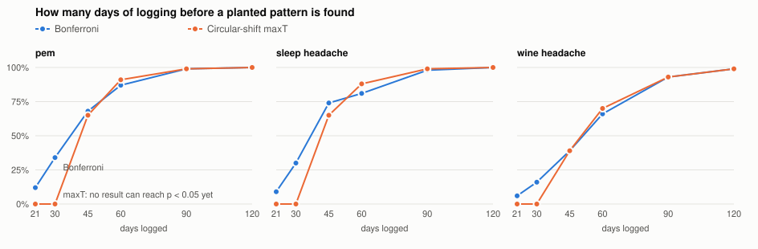

Statistics engine study, 100 fresh seeds per cell (tools only). Default method: `bonferroni`.

Method comparison at 70 days (detection = planted exposure is the top finding; false finding = any finding on a null history):

| Method | pem | sleep_headache | wine_headache | False finding, null | False finding, autocorrelated null |
|---|---|---|---|---|---|
| Bonferroni | 0.92 | 0.94 | 0.83 | 0.0 | 0.05 |
| Benjamini-Hochberg | 0.92 | 0.94 | 0.83 | 0.0 | 0.05 |
| Circular-shift maxT | 0.94 | 0.95 | 0.9 | 0.05 | 0.06 |

Detection rate vs. days of history (before ~8% random gaps):

| Persona | Method | 21 d | 30 d | 45 d | 60 d | 90 d | 120 d |
|---|---|---|---|---|---|---|---|
| pem | Bonferroni | 0.12 | 0.34 | 0.68 | 0.87 | 0.99 | 1.0 |
| pem | Circular-shift maxT | 0.0 | 0.0 | 0.65 | 0.91 | 0.99 | 1.0 |
| sleep_headache | Bonferroni | 0.09 | 0.3 | 0.74 | 0.81 | 0.98 | 1.0 |
| sleep_headache | Circular-shift maxT | 0.0 | 0.0 | 0.65 | 0.88 | 0.99 | 1.0 |
| wine_headache | Bonferroni | 0.06 | 0.16 | 0.39 | 0.66 | 0.93 | 0.99 |
| wine_headache | Circular-shift maxT | 0.0 | 0.0 | 0.39 | 0.7 | 0.93 | 0.99 |

